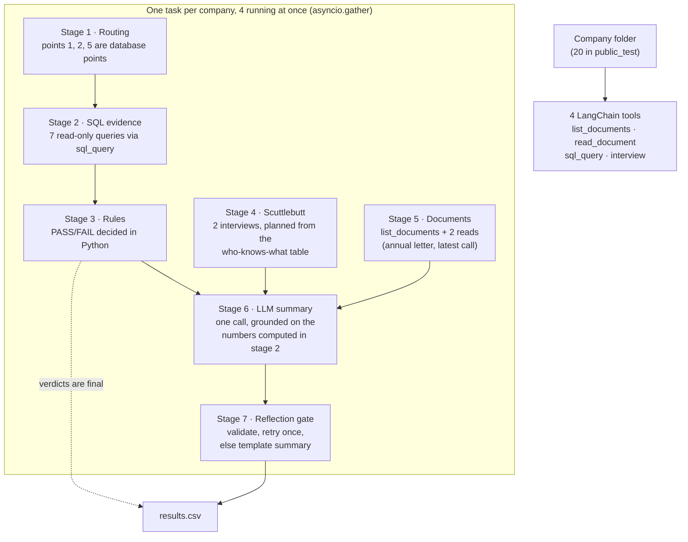

# FTEC5660 Homework 3: Fisher's 15-Point Investment Agent

Build a LangChain agent that researches a company with tools and applies the
framework from Philip Fisher's *Common Stocks and Uncommon Profits* (Part One,
Chapter 3 "What to buy: the fifteen points to look for in a common stock", and
Chapter 4 "What to buy: applying this to your own needs"). You choose 3 of
Fisher's 15 points and decide yourself what PASS means for each. For every
company your agent gives a PASS/FAIL verdict on your 3 points and a short
summary.

The companies are fictional, so the model cannot answer from memory. Unlike a
pile of reports, the evidence is spread over three sources, and your agent has
to go and get it with tools, the way Fisher's "scuttlebutt" method sends an
investor to talk to customers, competitors, suppliers and staff.

## Data and tools

`public_test/` has one folder per company. Your code receives four tools per
company (built by the provided code in `hw3.py`):

| Tool | What it gives you |
| --- | --- |
| `list_documents()` | the company's six documents and their dates |
| `read_document(name)` | one document: the 2025 letter to shareholders, four earnings calls (Q3 2025 to Q2 2026) and a news file (July 2025 to July 2026) |
| `sql_query(query)` | one read-only SQLite query on the company's database; at most 50 rows come back, so use `SUM`, `GROUP BY` and `WHERE` |
| `interview(role, topic)` | what one person says about the company; at most **10 interviews per company** |

The documents are what management says. Management's own claims (such as "we
have never cut research" or "our people are our greatest strength") are not
evidence on their own: check them against the database and the interviews.

**Database tables** (amounts in USD thousands; dates `YYYY-MM-DD`, months
`YYYY-MM`, quarters like `2025Q3`; the fiscal year is the calendar year):

| Table | Columns |
| --- | --- |
| `company` | name, industry |
| `industry_medians` | industry, revenue_growth_2y_pct, new_product_share_pct, new_product_sales_per_rd, operating_margin_pct (one row per industry; use the row for the company's own industry) |
| `orders` | order_id, order_date, product, customer, amount, note (about 3,000 to 4,000 orders from January 2023 to June 2026; revenue is the sum of order amounts) |
| `products` | product, launch_date |
| `monthly_costs` | month, cost_of_sales, selling_admin, research_development |
| `quarterly_cash` | quarter, operating_cash_flow, capex, cash_end |
| `capex_plan` | year, planned_capex (2026 to 2028) |
| `returns` | month, units_shipped, units_returned |
| `insider_trades` | trade_date, person, title, side (`buy` or `sell`), shares, price |

**Terms used in the data.**

| Term | Meaning |
| --- | --- |
| FY2025 | Fiscal year 2025. Here the fiscal year is the calendar year, so FY2025 is January to December 2025. |
| Quarter | Three months of the year: Q1 is January to March, Q2 April to June, Q3 July to September and Q4 October to December. The database writes `2025Q3`; the documents write "third quarter 2025". |
| Amounts | The database is in **USD thousands** (676,100 means US$676.1 million). The documents use USD millions. |
| Revenue | Money from sales: the sum of `amount` in `orders`. |
| Cost of sales | The cost of making the products that were sold. |
| Selling and admin | The cost of selling and of running the company (sales staff, offices, management). |
| R&D | Research and development spending, mainly on new products. |
| Operating margin | Operating profit as a share of revenue: (revenue − cost of sales − selling and admin − R&D) ÷ revenue. |
| Operating cash flow | Cash that the day-to-day business brings in during a quarter. |
| Cash at the end of a quarter | The cash the company holds on the last day of that quarter (`cash_end`). |
| Capex | Capital expenditure: spending on factories, machines and other long-term assets. `capex_plan` holds the planned capex for 2026 to 2028. |
| Return rate | Units returned ÷ units shipped, from the `returns` table. |
| Industry median | The middle value for companies in the same industry, from `industry_medians`. |
| Insider | A director or senior manager of the company. `insider_trades` lists the shares they bought (`buy`) or sold (`sell`). |
| Earnings call | A meeting each quarter where management presents the quarter's results to investors. Each call quotes that quarter's revenue. |

**Interviews.** Roles: `customer`, `current_employee`, `former_employee`,
`competitor`, `supplier`. Topics: `sales_team`, `working_conditions`,
`top_management`, `decision_making`, `competitive_edge`. Only some people know
about each topic; the others say they can't comment, and that answer still
uses up one interview.

| Topic | Who knows about it |
| --- | --- |
| `sales_team` | customer, competitor |
| `working_conditions` | current_employee, former_employee |
| `top_management` | former_employee, supplier |
| `decision_making` | supplier, customer |
| `competitive_edge` | competitor, customer |

People who know about a topic always agree with each other, so one good answer
is enough.

## Choose your 3 points and your rules

Pick any 3 of Fisher's 15 points and write them in `CHOSEN_POINTS` near the
top of `hw3.py`, e.g. `CHOSEN_POINTS = [1, 7, 15]`. The full questions are in
`FISHER_POINTS` in `hw3.py` and in the book.

| # | Fisher's point | Where the evidence is |
| --- | --- | --- |
| 1 | Market potential for sales growth | database |
| 2 | New products as current lines mature | database |
| 3 | Effective research and development | database |
| 4 | Above-average sales organization | interviews (`sales_team`) |
| 5 | Worthwhile profit margin | database |
| 6 | Maintaining or improving margins | database |
| 7 | Labour and personnel relations | interviews (`working_conditions`) |
| 8 | Executive relations | interviews (`top_management`) |
| 9 | Depth of management | interviews (`decision_making`) |
| 10 | Cost analysis and accounting controls | earnings calls, checked against the database |
| 11 | Advantage over competitors | interviews (`competitive_edge`) |
| 12 | Long-range outlook on profits | database |
| 13 | Growth without dilutive equity financing | database |
| 14 | Management talks freely about troubles | earnings calls, checked against the database |
| 15 | Management of unquestionable integrity | news file, checked against the database |

For each of your points, **you design the rule**: which evidence to use, what
to compute or whom to ask, and where the line between PASS and FAIL lies. PASS
means the company looks favourable on that point, as Fisher would see it.

We grade your verdicts against our own answer key. It uses one fixed rule per
point, which we do not publish, and the data never puts a company close to
the line of that rule, so a sensible reading of Fisher usually gives the same
answer. **Test your rules on the public answers**:
`public_test/ground_truth.json` gives the expected verdict on all 15 points
for each of the 20 public companies, and every point fails in 6 of them. If
your rule disagrees with the public answers, rethink it.

**Tip: calculate with tools, not in your head.** Do every sum, ratio and
comparison in SQL or Python, including the number of days between two dates
(SQLite's `julianday()` gives a date as a number of days).

## Student task

Fill in the three places in `hw3.py` marked `### YOUR CODE HERE`. You may add
imports, constants and helper functions above them, but do not change the
provided code below them:

- `CHOSEN_POINTS` lists your 3 points.
- `build_agent()` creates your model and anything else you need once.
- `analyze_companies(agent, companies)` receives
  `{company_folder: [list_documents, read_document, sql_query, interview]}`
  and returns, for every company,
  `{"points": {1: "PASS", 7: "FAIL", 15: "PASS"}, "summary": "..."}` (here with
  `CHOSEN_POINTS = [1, 7, 15]`).

Use the course techniques that fit your points: tool use for the database and
the interviews, planning which interviews to spend, routing each point to the
right source, prompt chaining, parallel calls, reflection to check your
answers, or a combination. Your code must read company data **only through
the four tools**; do not open `company.db` or `interviews.dat` yourself. Do
not hard-code folder names, company names or the public answers.

## Setup and public test

```bash
python3 -m venv .venv
source .venv/bin/activate
pip install -r requirements.txt
echo "DEEPSEEK_API_KEY=your_key_here" > .env
python3 hw3.py --data-folder public_test
```

Use your own DeepSeek API key (from https://platform.deepseek.com). The
required model is `deepseek-v4-flash`. We grade with our own key, so never put
a key in your code; `.env` must stay out of git.

The program creates `results.csv` with the columns `company`, `points`,
`points_correct`, `point_errors`, `interviews_used` and `summary`, and prints
the point score on your 3 points (the percentage after "balanced"). The point
score is the average of two shares: the share of truly passing verdicts that
you marked PASS and the share of truly failing verdicts that you marked FAIL.
For example, 90% and 60% give (90% + 60%) / 2 = 75%, and marking every point
PASS gives (100% + 0%) / 2 = 50%. Once `CHOSEN_POINTS` is set, the starter
runs before you add any API code (it returns no verdicts, so it scores 0%).

`public_test/ground_truth.json` gives the expected verdicts on all 15 points
for each public company. Grading uses a private set of about 20 unseen
companies with the same tools and the same answer key rules, but different
names and wording, and scores your 3 points only.

## Homework 3 solution:

**Points chosen: 1, 2 and 5.** They form one argument rather than three separate
checks. Point 1 asks whether there is a runway long enough to be worth owning;
point 2 asks whether the company refills that runway when today's products
mature; point 5 asks whether the growth is actually profitable. A company can
pass any one of them and still be a poor Fisher stock, but it is hard to pass
all three without being the kind of business he describes.

All three rules compare the company with the **median of its own industry**
instead of a fixed number. This matters: a 10% operating margin is respectable
in food ingredients and weak in medical devices, so an absolute threshold would
mostly be measuring the industry, not the company.

### My 3 points and rules

**Point 1 — market potential for sales growth**

> "Does the company have products or services with sufficient market potential
> to make possible a sizable increase in sales for at least several years?"

*Why:* this is the foundation of the whole framework. Fisher is not looking for
one good year; he wants a runway that lasts "at least several years", which is
why the rule uses a two-year change rather than the latest quarter.

*Rule:* **PASS** if revenue in the last complete fiscal year is at least
`revenue_growth_2y_pct` above revenue two years earlier, where that median is
the one for the company's own industry. Otherwise **FAIL**.

*Evidence:* `orders` only (`SUM(amount)` grouped by year), compared with
`industry_medians`. The "last complete fiscal year" is found from the data —
the year with twelve months of orders — so the partial 2026 in the database is
never compared with a full year.

**Point 2 — new products as current lines mature**

> "Does the management have a determination to continue to develop products or
> processes that will still further increase total sales potentials when the
> growth potentials of currently attractive product lines have largely been
> exploited?"

*Why:* point 1 measures the runway; point 2 measures whether the company is
building the next one. Fisher's concern is a company that looks excellent until
its current product matures and then has nothing behind it.

*Rule:* **PASS** if products launched on or after the first order date supply a
larger share of the last complete year's revenue than the industry median
`new_product_share_pct`. Otherwise **FAIL**.

*Evidence:* `products` joined to `orders` (`launch_date` decides what counts as
new, `amount` decides how much it sold), compared with `industry_medians`.

**Point 5 — a worthwhile profit margin**

> "Does the company have a worthwhile profit margin?"

*Why:* growth that does not turn into operating profit is not what Fisher means
by a good business, and margin is also the cheapest thing to check honestly —
it is pure arithmetic, with no management narrative in the way.

*Rule:* **PASS** if the operating margin for the last complete fiscal year,
`(revenue − cost of sales − selling and admin − R&D) ÷ revenue`, is above the
industry median `operating_margin_pct`. Otherwise **FAIL**.

*Evidence:* `orders` for revenue and `monthly_costs` for the three cost lines,
compared with `industry_medians`. The margin history (2023 → 2025) is also
computed and given to the model, but it does not change the verdict.

**Why not the interview points.** Points 4, 7, 8, 9 and 11 are better Fisher
questions in some ways, but their evidence is a paragraph of prose, so the
verdict would rest on the model's reading rather than on a reproducible
calculation. With ten interviews per company and a graded private set, I
preferred three points whose answer I can defend line by line in SQL.

### Design



The agent is deliberately split into a **deterministic core** and a **narrative
layer**. Stage 1 routes the three chosen points to the database, because that is
where their evidence lives. Stage 2 runs seven read-only queries through
`sql_query` and parses the pipe-separated output into numbers — every sum,
ratio and comparison happens in SQL or Python, never in the model's head, which
the assignment warns is the most common source of wrong verdicts. Stage 3 turns
those numbers into PASS/FAIL with three fixed comparisons against the industry
median, and those verdicts are final: nothing downstream can change them. Stage
4 spends exactly two of the ten interviews, picked from the README's
"who knows what" table so neither is wasted on somebody who cannot comment, and
stage 5 reads the annual letter and the most recent earnings call — the call is
chosen by date from `list_documents`, not by filename. Stage 6 is the only model
call per company: it receives the fact sheet, the three verdicts, the two
document extracts and the interview quotes, and writes a 2–4 sentence summary
that must not contradict the verdicts or invent a number. Stage 7 is the
reflection step — a code-level check that rejects a summary which is too short,
never states a verdict, or apologises instead of answering, and asks the model
once more before falling back to a template built from the same numbers. Twenty
companies run four at a time, so a full pass takes about 35 seconds.

| Point | Source | Tool calls | What decides the verdict |
| --- | --- | --- | --- |
| 1 | database | `sql_query` × 3 | Python comparison with `revenue_growth_2y_pct` |
| 2 | database | `sql_query` × 2 | Python comparison with `new_product_share_pct` |
| 5 | database | `sql_query` × 2 | Python comparison with `operating_margin_pct` |
| — | documents | `list_documents`, `read_document` × 2 | model, summary only |
| — | interviews | `interview` × 2 | model, summary only |

### Results

**Point score on `public_test`: 60/60 correct, balanced accuracy 100.0%**
(`1: 20/20`, `2: 20/20`, `5: 20/20`). Three consecutive runs gave the same
score in 31–42 seconds each, and two interviews per company were used, never
more. `results.csv` is regenerated by:

```bash
python3 hw3.py --data-folder public_test
```

**Companies where my verdicts disagree with the public answers: none.** Every
one of the 20 companies matches `ground_truth.json` on all three points, so
there is no disagreement to explain. What I can report honestly is where earlier
versions of the rules *did* disagree, because that is what shaped the final ones.

*I first tried point 3 (research effectiveness) and gave it up.* Three
reasonable readings of "effective R&D" all disagreed with the answer key on the
same six companies (`aurel_systems`, `driftwood_systems`, `dunmore_holdings`,
`halcyon_works`, `ironbark_technologies`, `lindale_holdings`), scoring 14/20
each: new-product sales ÷ R&D for the latest year, the same ratio cumulated over
2023–2026, and the same ratio lagged one year. Two other readings were worse —
R&D intensity (7/20) and "R&D spending was not cut" (12/20). The pattern in the
failures was a threshold, not a definition: every failing company sat below
about 1.5× the industry median while every passing company sat above about 2×.
That is a rule I could only have found by fitting the public answers, and the
assignment says the data never puts a company near the line — so a rule that
needs a fitted multiplier is a rule that will not transfer to the private set. I
dropped point 3 instead of tuning it.

*The rules that survived are the ones where the gap is structural.* Point 1
passes or fails by at least 3.1 percentage points, point 2 by at least 4.1, and
point 5 by at least 1.7, with no company near the boundary. That margin is the
reason I trust the result on unseen companies more than the 100% itself: the
rules never look at a company name, a folder name, or any wording from the
documents, and they derive every window from the data (first order date, last
year with twelve months of orders) rather than from the calendar year 2025.

*What the summaries add.* The verdicts are arithmetic, but the summaries are
where the triangulation shows up. `ashgrove_labs` fails point 2, and the model
noticed that the annual letter's emphasis on long-term research "is not showing
up in new-product contribution", while a customer calling the product a
commodity points the same way. On `hollins_group` management says the sales team
is "second to none"; that claim is not tested by these three points, but the
summary is instructed to flag any claim the numbers contradict, which is the
habit Fisher's scuttlebutt method is really about.

*Where this design could still lose points.* The main risk is a private company
whose industry row is missing from `industry_medians`; the code then falls back
to fixed thresholds (12% growth, 22% new-product share, 12% margin) instead of
failing, which is a guess rather than a rule. The second risk is a company with
fewer than three complete fiscal years, where the two-year window has to shrink
to whatever is available. Neither happens anywhere in `public_test`, so both
paths are untested against real answers.

---

**Task 2 (Reflection)** is in [`reflection.pdf`](reflection.pdf).

